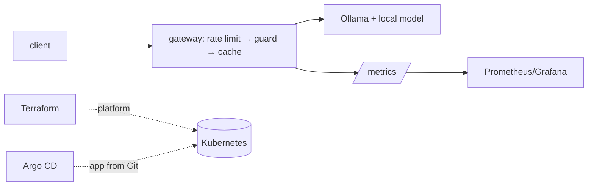

# AI Platform Academy

A hands-on, self-paced lab for building an AI service that runs on a **local LLM**, then containerizing, orchestrating and operating it with **Docker, Kubernetes and Terraform**, plus the platform-engineering practices around it (GitOps, policy, golden paths).

> Independent self-study, inspired by the *structure* of project-based AI-engineering programs (design → systems → engineering → build → showcase). Not affiliated with any institution; no course content is copied.

## What you build



## Modules

| # | Module | You learn | Phase |
|---|---|---|---|
| 00 | Setup | toolbox | |
| 01 | Design | concepts, invariants, what the system must refuse | Design |
| 02 | Local LLM | Ollama API, latency | Systems |
| 03 | Containerize | hardened image, Compose | Systems |
| 04 | Kubernetes | deploy, probes, scaling, quotas | Systems |
| 05 | Terraform | platform layer as code, import, Helm | Systems |
| 06 | CI/CD + GitOps | Actions, GHCR, Argo CD | Systems |
| 07 | Platform engineering | RBAC, Kyverno, golden path, Backstage | Platform |
| 08 | Evaluate and harden | evals, benchmarks, threat model | Engineering |
| 09 | Capstone | ship and present your own | Build |

See [LEARNING_PATH.md](LEARNING_PATH.md) for a 12-week schedule and certification mapping.

## Quickstart

```bash
python -m venv .venv && source .venv/bin/activate
pip install -r requirements-dev.txt
python -m pytest -q            # 4 xfails are intentional bypass exercises
python modules/01-design/sim/simulate.py
python -m tutor modules        # needs Ollama for ask/quiz
```

Then follow `modules/00-setup/README.md`. Check each module with `make verify-NN`; mark it with `python -m tutor done NN`.

Phone-friendly: see [PHONE.md](PHONE.md) (GitHub Codespaces).

## The tutor

`python -m tutor ask 04 "why do we need a readiness probe?"` and `python -m tutor quiz 04` use your local model and the module text. Small models are sometimes wrong: tests and `make verify-NN` are the source of truth.

## Honest limits
Written without access to a live cluster, Docker daemon, Ollama or Terraform: Python tests ran; manifests and Terraform were syntax-checked only. Expect to fix small things (chart versions, image tags) as you go. That is part of the lab. Further reading: Daniel Jackson, *The Essence of Software* (concept design).
